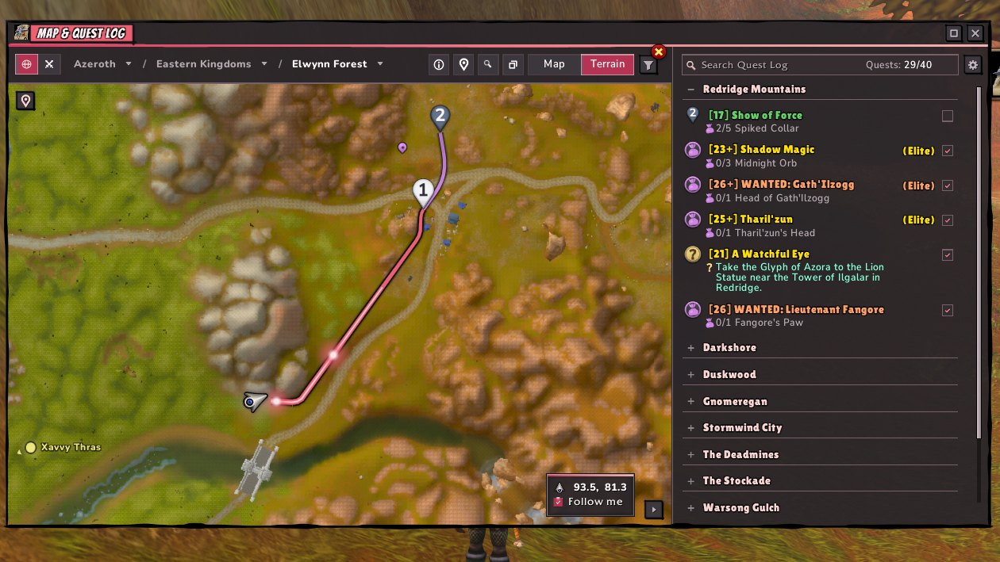

# Shy Ground

  
  
  
  
  

**Needs [Shy](https://github.com/shyce/Shy).** This is only map data, with nothing to see or set up, and it does
nothing on its own.

It holds the ground of each world in three dimensions, read from the game's own files, so your routes go around the
cliff instead of into it. Each world is an addon of its own (`ShyWay_Ground_<world>`), loaded only while you're in
that world.

## Install

It's optional: without it, the arrow points straight at where you're going. Get it from CurseForge, or by hand copy
every folder here into `World of Warcraft\_forever_\Interface\AddOns`.

## Community

Questions and bug reports: [join the Discord](https://discord.gg/tuJ8EbDdSU).

## License

Free software under the GNU General Public License, version 3 (`LICENSE.txt` in every folder). The ground is
drawn from the game's own files; World of Warcraft and its art belong to Blizzard Entertainment.

A commit here is the release it came with, made only when the ground changed.
